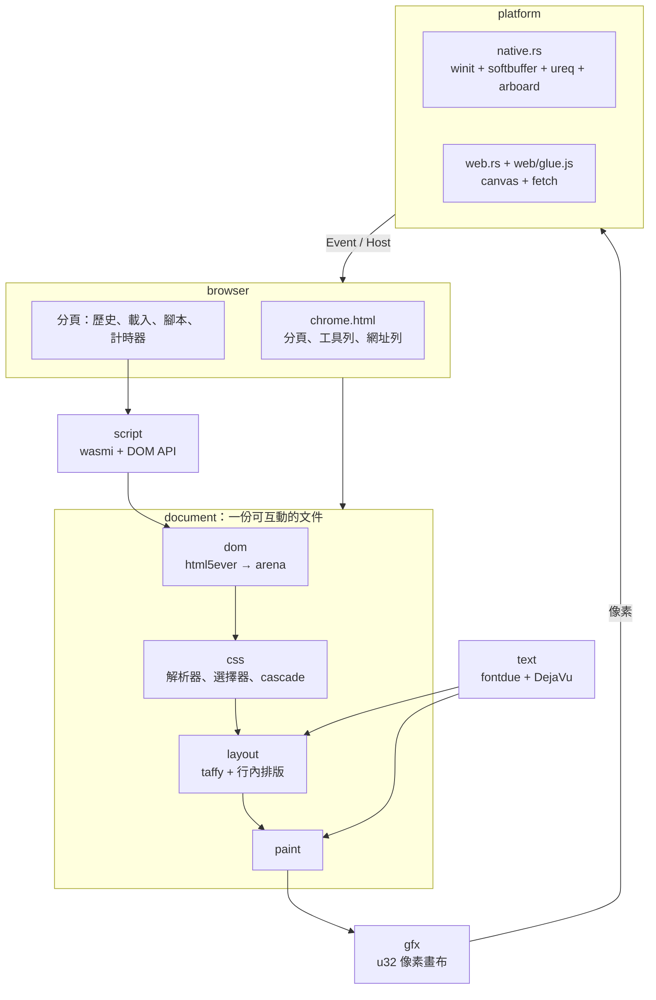
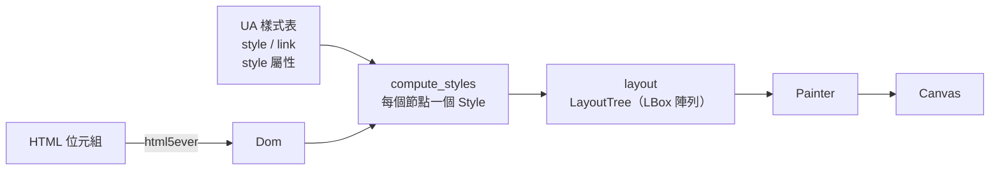
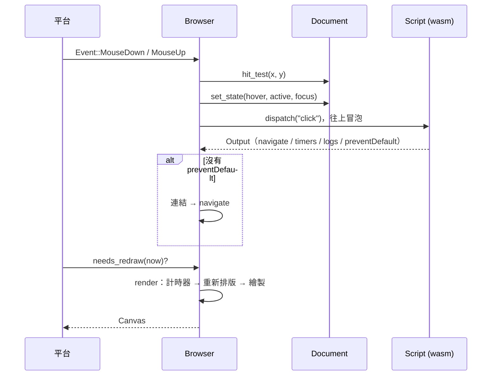

# rubrowser 架構

rubrowser 把整個瀏覽器畫在**一塊空白畫布**上：原生版是視窗裡的一塊像素緩衝區，網頁版是單一 `<canvas>`。網頁的 HTML + CSS 由 rubrowser 自己排版、繪製；瀏覽器自己的介面（分頁、網址列、按鈕）也是一份 HTML 文件，走同一套引擎。

## 1. 總覽



| 模組 | 職責 |
|---|---|
| `gfx` | `Canvas`：`0x00RRGGBB` 像素、裁切、alpha 混色、反鋸齒圓角矩形 |
| `text` | 系統的 Arial / Georgia（有的話）或內附 DejaVu Sans / Serif / Mono，缺字時退回 DejaVu 與系統中文字型；量測、字形快取、繪製 |
| `dom` | 以 `NodeId` 索引的節點陣列；`html5ever` 透過 `TreeSink` 直接建樹 |
| `css` | 自寫的 CSS 解析器（`@media`、`@supports`、`@layer`、`@import`、巢狀）、選擇器引擎、依最右側選擇器分桶的 cascade、`var()` / `calc()`、偽元素與 `content`、computed `Style` |
| `layout` | box tree；block / flex / grid / float 交給 `taffy`，行內內容是自己算的葉節點；`::before` / `::after` 是 DOM 之後的合成節點 |
| `paint` | 背景、邊框、圓角、文字、底線、清單符號、輸入框、捲軸 |
| `document` | 把上面串成一份文件：重新計算、hit-test、hover / focus、捲動、輸入框狀態 |
| `script` | 在 wasmi 中執行網頁的 wasm，提供 DOM API（見 [abi.md](abi.md)） |
| `lang` | 語言 runtime：`lang::js` 把 boa 編成 `js.wasm`（見 [javascript.md](javascript.md)、[languages.md](languages.md)） |
| `document::forms` / `document::image` | 表單控制項狀態、圖片解碼與縮放快取；SVG 以 `resvg` 依繪製大小點陣化 |
| `browser` | 外框文件、分頁、歷史、載入、事件分派、快捷鍵 |
| `net::url` | 網址列輸入、相對網址解析 |
| `ui::TextField` | `<input>` 的編輯邏輯：游標、選取、單字移動、剪貼簿 |
| `platform` | 原生視窗與網頁 canvas 的轉接層 |
| `sdk` | 給網頁作者的 Rust API（只需 `sdk` feature，無依賴） |

## 2. 一份文件的處理流程



`Document::update` 只在需要時重做：

- DOM 改變、hover / focus 改變 → 重新計算樣式；樣式有變才重新排版。
- 視窗尺寸改變 → 重新排版。

### 排版

1. 從 `<html>` 往下建 taffy 節點。每個元素的子節點分成兩類：
   - **區塊層級**（block、flex、list-item、絕對定位）→ taffy 子節點。
   - **行內內容**（文字、inline 元素攤平後的內容、`<br>`）→ 收集成 `inline::Content`。
2. 只有行內內容的區塊本身就是 taffy 葉節點；混合時，每段行內內容包成一個匿名區塊。Flex 容器的每個子元素都是 flex item。
3. `inline-block` 先用獨立的 taffy 樹以 shrink-to-fit 排好，再當成一個大字形放進行內排版，並以其最後一行的基線對齊。
4. 葉節點的大小由 measure 函式呼叫行內排版（空白處理、斷行、基線、行高）取得。
5. taffy 算完後轉成 `LBox`，位置相對於父盒子。捲動位移在繪製與 hit-test 時才套用。

## 3. 瀏覽器外框

`browser/chrome.html` 是一份普通的 HTML 文件：

```html
<div id="tabbar"><div id="tabs"></div><button data-action="new-tab">+</button></div>
<div id="toolbar">
  <button data-action="back">←</button> … <input id="address">
</div>
<div id="viewport"></div>
```

- 外框文件以整個視窗大小排版；目前分頁的文件以 `#viewport` 的內容區大小排版，畫在它上面。
- 點擊帶有 `data-action` 的元素會執行瀏覽器指令（`new-tab`、`close-tab`、`back`、`forward`、`reload`）；點分頁（`data-tab`）會切換分頁。
- 分頁列和按鈕狀態由 Rust 直接修改外框 DOM 來更新；只有內容真的改變時才重建，以免使用者點擊時元素被換掉。
- 連結預覽 `#status` 是外框的一部分，但在頁面之後再畫一次，所以會疊在頁面上。

## 4. 事件流程



- 座標一律是**邏輯像素**；繪製時乘上顯示器的縮放比例，所以高 DPI 螢幕上文字依然清晰。
- 只有狀態改變、計時器到期或游標閃爍時才重畫；`next_wakeup` 告訴平台下次該醒來的時間。

## 5. 載入

| 網址 | 來源 |
|---|---|
| `about:home`、`about:counter`… | 編進執行檔的頁面（`browser/pages/`），旁邊的 `.wasm` 也是 |
| `http://`、`https://` | 原生版用 `ureq`（背景執行緒），網頁版用 `fetch` |
| `file://`、本機路徑 | 原生版讀檔 |

每次換頁會遞增分頁的 `serial`，晚到的舊回應會被丟棄。樣式表與腳本在 HTML 解析後依文件順序取得。

## 6. 平台介面

平台只需要做兩件事：

1. 把輸入轉成 `input::Event` 交給 `Browser::event`，在需要時呼叫 `Browser::render` 並把像素顯示出來。
2. 實作 `input::Host`：

```rust
pub trait Host {
    fn fetch(&mut self, id: u32, url: &str);       // 完成後呼叫 Browser::fetch_done
    fn clipboard_get(&mut self) -> Option<String>;
    fn clipboard_set(&mut self, text: &str);
    fn set_cursor(&mut self, cursor: Cursor);
    fn set_title(&mut self, title: &str);
    fn log(&mut self, message: &str) {}
}
```

網頁版不使用 wasm-bindgen：Rust 只匯出 `extern "C"` 函式，`web/glue.js` 負責把事件、fetch 結果、游標、標題和剪貼簿透過一塊共用緩衝區傳來傳去。
