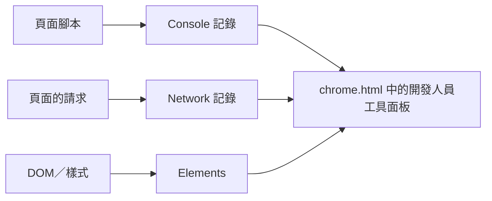
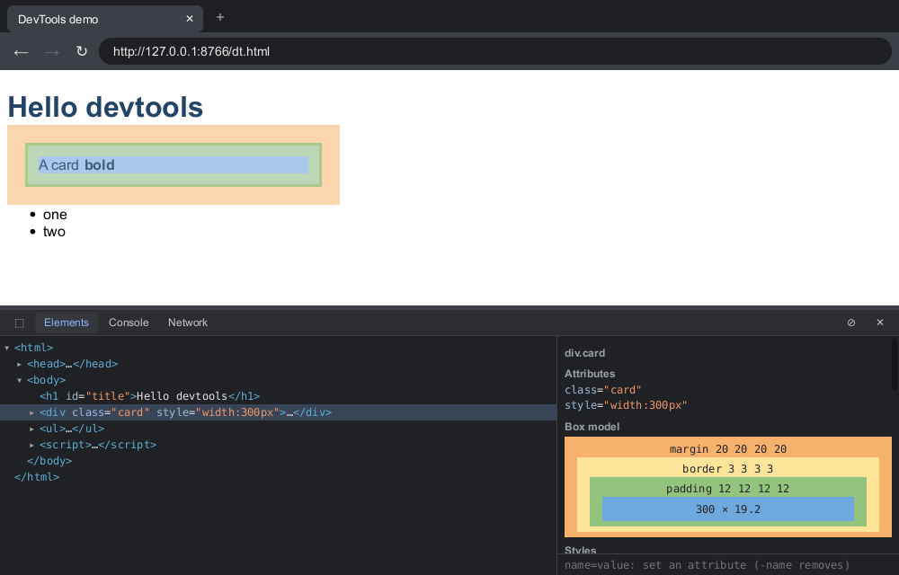
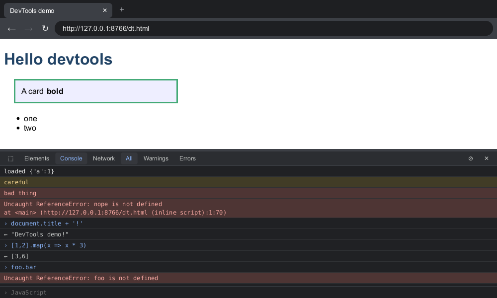
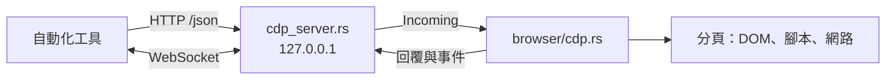

# 開發人員工具

rubrowser 的開發人員工具有六個面板（F12），另外可以用 Chrome DevTools Protocol 從外部程式遠端除錯（第 8 節）。面板：Elements、Console、Network、Sources、Application 與 Performance，可檢查頁面 DOM 與樣式、執行 JavaScript、查看網路請求、閱讀原始碼、管理儲存資料，並找出慢的腳本與畫面。

## 1. 開啟與操作

| 操作 | 快捷鍵／按鈕 |
|---|---|
| 開啟或關閉開發人員工具 | `F12` |
| macOS 開啟或關閉 | `Cmd+Opt+I`（`⌥⌘I`） |
| 其他平台開啟或關閉 | `Ctrl+Shift+I` |
| 進入「選取元素」模式 | macOS `Cmd+Shift+C`、其他平台 `Ctrl+Shift+C`，或工具列的 `⬚` 按鈕 |
| 離開「選取元素」模式 | `Escape` |
| 關閉開發人員工具 | 工具列的 `✕` 按鈕 |
| 清除記錄 | 工具列的 `⊘` 按鈕，可清除 Console 或 Network 記錄 |

頁面右鍵選單中的「檢查」會選取游標下的元素。

開發人員工具停靠於頁面下方，頁面區域會隨之縮短。可拖曳上緣調整高度，最低為 80px，預設高度為 300px。

工具是瀏覽器自身 chrome document 的一部分（`src/browser/chrome.html`），內容由 Rust 根據瀏覽器狀態產生（`src/browser/devtools.rs`）。面板本身不使用 JavaScript，因此即使頁面腳本卡住，仍可開啟使用。Console 與 Network 記錄各自屬於目前分頁，並在每次導覽後重新開始。此功能沒有新增相依套件。





## 2. Elements

Elements 面板顯示頁面的 DOM 樹：

- 初始時展開 `html` 與 `body`。
- 使用 `▸`／`▾` 展開或收合元素。
- 若元素只有一個短文字子節點，文字會直接顯示在元素列上；純空白文字節點則隱藏。
- 最多顯示 3000 列；頁面變更 DOM 時，樹最多每 300 毫秒重新整理一次。
- 游標停在元素列上時，會在頁面上標示其盒模型：邊距為橙色、邊框為黃色、內距為綠色、內容為藍色。

所選元素的側欄包含：

| 區段 | 內容 |
|---|---|
| 元素摘要 | `tag#id.class`、屬性 |
| Box Model | 邊距、邊框、內距的數值與內容尺寸 |
| Styles | 先顯示 `element.style`，再顯示相符的 CSS 規則；勝出的規則排在前面，使用者代理規則另有標記 |
| Computed | `display`、`position`、尺寸、邊距、內距、色彩、字體、flex、overflow、opacity、z-index 等常用屬性 |

Styles 中每條宣告前有一個勾選框（☑／☐），點一下即可暫時關閉或重新開啟該宣告，頁面立即重新套用樣式；關閉的宣告以刪除線顯示。作者的規則與 `element.style` 都可以切換，瀏覽器內建（user agent）規則不能。規則的開關記在文件上（不改動樣式表本身），換頁後就恢復。

側欄下方的編輯行可修改元素，按 `Enter` 套用：

| 輸入 | 效果 |
|---|---|
| `name=value` | 設定屬性 |
| `-name` | 移除屬性 |
| `prop: value` | 設定 `element.style` 的屬性（例如 `color: red`） |
| 任意文字（選取文字節點時） | 取代該文字節點的內容 |

## 3. Console

Console 記錄頁面腳本、錯誤及失敗的請求：

| 訊息來源 | 顯示方式 |
|---|---|
| `console.log`、`console.info`、`console.debug` | 一般訊息 |
| `console.warn` | 黃色訊息 |
| `console.error`、未捕捉例外 | 紅色訊息，並顯示 stack |
| 失敗的請求、腳本錯誤 | 列入 Console |

重複的相同訊息會合併計數，並以徽章顯示次數。可使用 `All`、`Warnings`、`Errors` 篩選器。

Console 底部的輸入行會在頁面中以全域腳本方式執行 JavaScript，輸出格式如下：

- 程式碼顯示為 `› code`。
- 結果顯示為 `← result`。
- 字串加上引號，物件以 JSON 顯示。
- 元素顯示為 `<tag> tag#id.class`，函式顯示為 `ƒ name()`。
- 例外顯示為 `Uncaught ...`。
- 最後一個結果存放在 `$_`。

使用 `Up`／`Down` 方向鍵可叫出先前輸入。若已使用 `--no-js` 停用網頁 JavaScript，Console 會顯示相關提示。



## 4. Network

Network 面板記錄頁面的每個請求，包括文件、樣式表、腳本與模組、圖片、字型、`fetch`／`XMLHttpRequest` 及下載。

| 欄位 | 顯示內容 |
|---|---|
| Name | URL 最後一段路徑與查詢字串 |
| Status | HTTP 狀態碼、`(failed)`，或等待中的 `…` |
| Type | 請求類型 |
| Size | 大小 |
| Time | 毫秒，依 wall clock 計算 |

失敗的請求與 HTTP 狀態碼大於或等於 400 的列會以紅色顯示；被封鎖的跨來源請求會顯示為 failed。

點選任一列可查看詳細資料：

| 詳細資料 | 內容 |
|---|---|
| General | URL、方法、狀態與類型 |
| Response Headers | 回應標頭 |
| Request Payload | 請求內容類型與內容 |
| Response | 文字回應預覽最多 20000 個字元；二進位內容顯示類型與大小 |

面板最多保留 1000 個請求，每個 body 最多保留 256 KB。

## 5. Sources

左側列出頁面的原始碼，右側顯示內容與行號（每個檔案最多顯示 5000 行）：

| 類型 | 來源 |
|---|---|
| HTML | 頁面文件本身 |
| JS | 外部腳本與模組（載入時保存，每個最多 4 MB），以及行內 `<script>` |
| CSS | 外部樣式表，以及行內 `<style>` |

## 6. Application

| 區段 | 內容 |
|---|---|
| Local storage／Session storage | 每個 key 與 value；✕ 刪除單筆 |
| Cookies | `document.cookie` 的每個 cookie；✕ 刪除 |
| Blob URLs | `URL.createObjectURL` 建立的網址、型別與大小 |

- `localStorage`、`sessionStorage` 與 cookie 都保存在頁面的 JavaScript runtime 裡，面板經由 runtime 取得快照；切到這個面板或按 Refresh 時更新，修改後自動更新。頁面沒有執行過 JavaScript 時這些區段是空的。
- 下方輸入行：`key=value` 設定 `localStorage`，`session key=value` 設定 `sessionStorage`。
- 工具列的 ⊘ 清除這一頁全部的 storage 與 cookie。

## 7. Performance

| 區段 | 內容 |
|---|---|
| Frames | 最近 120 個畫面的長條圖：藍色是更新（計時器、樣式、排版），綠色是繪製；平均與最慢的毫秒數 |
| Script calls | 每次呼叫頁面腳本的時間與執行的 wasm 指令數（fuel），依種類（event、timer、fetch、websocket、script、start）加總 |
| Slowest calls | 最慢的 15 次呼叫，例如 `event click`、`timer`、腳本網址 |

紀錄保留最近 500 次呼叫，換頁時重新開始；面板開著時約每秒更新一次。開發人員工具自己的 storage 快照不計入。

## 8. 遠端除錯（Chrome DevTools Protocol）

rubrowser 可以用 [Chrome DevTools Protocol](https://chromedevtools.github.io/devtools-protocol/)（CDP）讓外部工具檢查與操控頁面，例如自動化測試、`chrome-remote-interface` 或自己寫的腳本。

```bash
rubrowser --remote-debugging-port 9222 https://example.com/          # 有視窗
rubrowser --headless --remote-debugging-port 9222 https://example.com/  # 沒有視窗
```

- 只聽 `127.0.0.1`；`Host` 標頭不是 `localhost`、`127.0.0.1` 或 `[::1]` 的請求一律拒絕（403），防止網頁經由 DNS rebinding 連進來（與 Chrome 相同）。
- 啟動時在 stderr 印出 `DevTools listening on ws://127.0.0.1:PORT/devtools/browser/rubrowser`；埠號給 `0` 時由系統挑一個空的。
- `--headless` 沒有視窗，一直執行到客戶端送出 `Browser.close` 或程序被結束；計時器、網路與頁面事件照常進行。



### HTTP 端點

| 路徑 | 回應 |
|---|---|
| `/json/version` | 瀏覽器名稱、協定版本、browser 連線的 `webSocketDebuggerUrl` |
| `/json`、`/json/list` | 每個分頁一個 target（`id`、`title`、`url`、`webSocketDebuggerUrl`） |
| `/json/new?URL` | 開新分頁 |
| `/json/activate/ID`、`/json/close/ID` | 切換到、關閉分頁 |

WebSocket 路徑：`/devtools/page/ID` 直接連到一個分頁；`/devtools/browser/rubrowser` 連到整個瀏覽器，用 `Target.attachToTarget`（`flatten: true`）取得 `sessionId` 後，訊息帶上它就送到那個分頁。

### 支援的方法

| Domain | 方法與事件 |
|---|---|
| Browser | `getVersion`、`close` |
| Target | `getTargets`、`createTarget`、`closeTarget`、`activateTarget`、`attachToTarget`、`detachFromTarget`、`setDiscoverTargets`；事件 `targetCreated`、`targetDestroyed`、`targetInfoChanged`、`attachedToTarget` |
| Page | `navigate`、`reload`、`getFrameTree`、`getNavigationHistory`、`getLayoutMetrics`、`captureScreenshot`（PNG，頁面區域）、`bringToFront`；事件 `frameNavigated`、`domContentEventFired`、`loadEventFired`、`lifecycleEvent`（`init`、`DOMContentLoaded`、`load`）、`frameStoppedLoading` |
| Runtime | `evaluate`、`callFunctionOn`（支援 `awaitPromise`、`returnByValue`、`objectGroup`；`callFunctionOn` 可指定 `objectId` 當 `this`、以 `{objectId}` 傳物件參數）、`getProperties`（`ownProperties`、`accessorPropertiesOnly`）、`releaseObject`、`releaseObjectGroup`；事件 `executionContextCreated`、`executionContextsCleared`、`consoleAPICalled`、`exceptionThrown` |
| Debugger（rujse runtime） | `enable`、`disable`、`setBreakpointByUrl`、`removeBreakpoint`、`setPauseOnExceptions`、`getScriptSource`、`pause`；暫停時 `resume`、`stepOver`、`stepInto`、`stepOut`、`evaluateOnCallFrame`、`Runtime.evaluate`、`Runtime.getProperties`；事件 `scriptParsed`、`paused`（呼叫堆疊、每層的 scope 與 `this`）、`resumed` |
| DOM | `getDocument`、`querySelector`、`querySelectorAll`、`describeNode`、`requestChildNodes`、`getOuterHTML`、`getAttributes`、`setAttributeValue`、`removeAttribute`、`setNodeValue`、`getBoxModel`、`focus`、`scrollIntoViewIfNeeded`；事件 `setChildNodes`、`documentUpdated` |
| CSS | `getComputedStyleForNode`、`getMatchedStylesForNode`、`getInlineStylesForNode` |
| Network | `getResponseBody`；事件 `requestWillBeSent`、`responseReceived`、`loadingFinished`、`loadingFailed` |
| Input | `dispatchMouseEvent`（按下、放開、移動、滾輪）、`dispatchKeyEvent`、`insertText` |
| Overlay | `highlightNode`（在頁面上標出盒子模型）、`hideHighlight` |
| Log | 事件 `entryAdded` |

- `X.enable` 開始送出該 domain 的事件，`X.disable` 停止；另外有幾個只是調整設定的方法（例如 `Page.setLifecycleEventsEnabled`、`Network.setCacheDisabled`、`Target.setAutoAttach`）接受但不做事。其他方法回傳錯誤 `-32601`。
- DOM 的 `nodeId` 就是 rubrowser 節點編號加 1，同一份文件中不會變。
- Remote object：物件與函式的結果帶 `objectId`（在請求的 `objectGroup` 中，直到釋放），可轉成 JSON 的值也一併帶 `value`；`returnByValue` 只傳值。`getProperties` 列出屬性時不執行 getter，`[[Prototype]]` 放在 `internalProperties`；rujse runtime 另外列出 JavaScript 看不到的引擎狀態（`[[PromiseState]]`、`[[PromiseResult]]`、Map／Set 的 `[[Entries]]`、`[[FunctionLocation]]`、bound function、Proxy、generator 狀態）。
- Debugger 需要 rujse runtime（`--features rujse`）。腳本停在中斷點時，瀏覽器的主執行緒停在那個腳本的呼叫裡，由 runtime 跑巢狀的訊息迴圈（和 Chrome 相同）：該連線的訊息直接從除錯伺服器的執行緒送到暫停中的 runtime（`script::debug`）。暫停期間只接受上表列的命令，其他命令回錯誤；恢復後送來的訊息照常處理。`enable` 之後編譯的腳本才會送出 `scriptParsed`；中斷點依 URL 設定，換頁後在新的 runtime 中重新設定。
- `load` 在頁面的腳本執行完後送出（rubrowser 的 `load` 事件時機），不等圖片載入完成。

相依套件：[serde_json](https://github.com/serde-rs/json)（MIT 或 Apache-2.0）處理 JSON；WebSocket 伺服器用原本就有的 [tungstenite](https://github.com/snapview/tungstenite-rs)（MIT 或 Apache-2.0）。

## 9. 截圖與測試

開發人員工具可透過命令列指定面板：

```bash
rubrowser --screenshot out.png --devtools console URL
```

| 選項 | 行為 |
|---|---|
| `--devtools console` | 開啟 Console 面板 |
| `--devtools elements:.card` | 開啟 Elements 面板，並選取第一個符合 `.card` CSS selector 的元素 |
| `--devtools network` | 開啟 Network 面板 |
| `--devtools sources`、`application`、`performance` | 開啟其他面板 |

`RUBROWSER_INPUT` 接受 `console CODE`（在 Console 執行 `CODE`）與 `key f12` 等輸入。例如：

```bash
RUBROWSER_INPUT="console document.title" rubrowser --screenshot out.png --devtools console https://example.com/
```

執行開發人員工具測試：

```bash
cargo test devtools
```

`src/browser/mod.rs` 中有 9 項開發人員工具的測試，涵蓋開啟／關閉／調整大小、Console、Elements、選取元素模式與右鍵選單、Network、Sources、Application、Performance，以及 Styles 的宣告開關與編輯；另有 2 項 CDP 測試（`cargo test cdp`）。

遠端除錯的端對端測試（只用 Python 標準函式庫，內含一個小型 WebSocket 客戶端）：

```bash
cargo build && scripts/cdp-test.py
```

它啟動本機 HTTP 伺服器與 `rubrowser --headless --remote-debugging-port 0`，檢查 `/json` 端點與 `Host` 檢查、導覽與載入事件、主控台事件、`Runtime.evaluate`（含 promise 與例外）、`callFunctionOn`、網路事件與回應內容、DOM 查詢與修改、計算後樣式與套用的規則、用 `Input` 點按鈕與輸入文字、截圖、flatten session、開關分頁，最後用 `Browser.close` 結束。

## 10. 尚未支援

- 內建開發人員工具 Sources 面板的中斷點與逐步執行（CDP 的 `Debugger` 已可用，需 rujse runtime；boa 沒有除錯 API）
- `enable` 之前已載入的腳本的 `scriptParsed`、`Debugger.setVariableValue`、非同步呼叫堆疊
- CDP 的 `Fetch`（攔截請求）、`Emulation`
- Chrome 自己的 DevTools 前端（它需要的 domain 比這裡多得多）