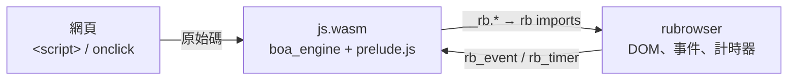

# JavaScript 支援

rubrowser 本身只執行 WebAssembly。JavaScript 的做法是：**把 JS 引擎編成 wasm**，再把網頁的 JS 原始碼交給它執行。



- **引擎**：[boa_engine](https://crates.io/crates/boa_engine)，純 Rust、支援 ES2023 以上的大部分語法與內建物件。
- **runtime**：`src/lang/js.rs`（feature `js-runtime`），編譯成 `src/browser/runtimes/js.wasm`（約 4 MB），內嵌在瀏覽器裡。
- **沙箱**：和其他 wasm 腳本相同，受 fuel（每次呼叫 20 億條 wasm 指令）與記憶體（512 MiB）限制；無法存取檔案或網路。
- 同一頁的所有 JS 共用一個 runtime instance，所以 `<script>` 之間共享全域變數，和一般瀏覽器相同。

## 1. 用法

```html
<button id="btn">Click</button>
<p id="out"></p>

<script>
  let n = 0;
  document.getElementById('btn').addEventListener('click', () => {
    document.getElementById('out').textContent = `clicked ${++n}`;
  });
</script>
<script src="app.js"></script>
<button onclick="alert('hi')">inline handler</button>
```

- 內嵌與外部 `<script>` 依文件順序執行（外部檔案並行下載）。
- `type` 為空、`text/javascript`、`module` 等都視為 JavaScript；`application/wasm` 則直接當 wasm 模組執行。
- `on…="…"` 屬性（`onclick`、`onload`…）在所有腳本之前登記，執行時才查找全域函式。
- 所有腳本執行完後，依序觸發 `DOMContentLoaded`（document）和 `load`（body）。

內建範例：`about:js-todo`（class、樣板字串、事件委派）、`about:calc`（inline `onclick`、鍵盤）。

## 2. 可用的 API

| 類別 | 支援 |
|---|---|
| 語言 | boa 支援的 ECMAScript：`let/const`、箭頭函式、class、解構、展開、樣板字串、`Map/Set`、`Promise`、`async/await`、`Proxy`、正規表示式、`JSON`、`Math`、`Date` … |
| `document` | `getElementById`、`querySelector(All)`、`getElementsByTagName/ClassName`、`createElement`、`createTextNode`、`body`、`head`、`documentElement`、`title`、`addEventListener` |
| 節點 | `parentNode`、`parentElement`、`childNodes`、`children`、`firstChild`、`nextSibling`、`firstElementChild` …、`textContent`、`appendChild`、`append`、`prepend`、`insertBefore`、`removeChild`、`replaceChild`、`remove`、`before`、`after`、`replaceWith`、`contains`、`cloneNode` |
| 元素 | `id`、`className`、`classList`、`style`（含 `setProperty`）、`dataset`、`innerHTML`、`outerHTML`、`innerText`、`value`、`hidden`、`disabled`、`getAttribute` 等、`matches`、`closest`、`insertAdjacentHTML`、`click()` |
| 事件 | `addEventListener`（含 `once`）、`removeEventListener`；事件物件的 `type`、`target`、`currentTarget`、`key`、`keyCode`、`shiftKey/ctrlKey/altKey/metaKey`、`clientX/clientY`、`button`、`preventDefault()`、`stopPropagation()`；`window.onload` 等屬性 |
| 計時 | `setTimeout`、`setInterval`、`clearTimeout`、`clearInterval`、`requestAnimationFrame`、`queueMicrotask`、`performance.now()`、`Date.now()` |
| 其他 | `console.log/info/warn/error`、`alert`（寫到主控台）、`location.href`（讀取與換頁）、`history.back/forward/go` |

尚未支援：`fetch` / `XMLHttpRequest`、`localStorage`、`getComputedStyle`、`getBoundingClientRect`、canvas、表單送出事件（第二階段 H12 後補）。

## 3. 錯誤

未捕捉的例外會以 `Uncaught …` 寫到主控台（原生版在終端機的 stderr，網頁版在瀏覽器的 console），同一頁的其他腳本與事件處理照常執行。超過 fuel 上限（例如無窮迴圈）時，該頁的 JS runtime 會被停止。

## 4. 建置 runtime

`js.wasm` 已提交在 repo 中；修改 `src/lang/js.rs` 或 `src/lang/prelude.js` 後需要重新建置：

```bash
./scripts/build.sh
```

它會執行：

```bash
cargo build --profile page --target wasm32-unknown-unknown --no-default-features --features js-runtime --example js_runtime
```

在 `wasm32-unknown-unknown` 上沒有作業系統的時間與亂數，所以 runtime 自己提供：

- **時間**：自訂 boa `Clock`，透過 `now` / `wall_time` imports 向瀏覽器取得。
- **亂數**：`getrandom` 的 custom backend（`.cargo/config.toml` 設定 `getrandom_backend="custom"`），以時間為種子。

測試 `embedded_js_runtime_is_up_to_date` 會檢查 `js.wasm` 是否包含目前的 `prelude.js`，忘了重建時會失敗。

## 5. 加入其他語言

任何能編成 wasm、並實作 [abi.md](abi.md) 中 runtime 協定（`rb_alloc`、`rb_eval`）的直譯器，都能用同樣的方式加入，例如把 RustPython 編成 `python.wasm` 來支援 `<script type="text/python">`。
