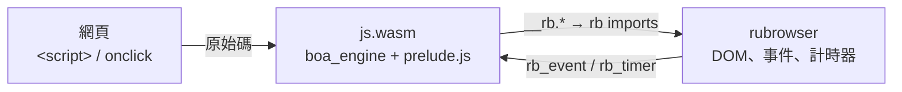

# JavaScript 支援

rubrowser 本身只執行 WebAssembly。JavaScript 的做法是：**把 JS 引擎編成 wasm**，再把網頁的 JS 原始碼交給它執行。



- **引擎**：[boa_engine](https://crates.io/crates/boa_engine)，純 Rust、支援 ES2023 以上的大部分語法與內建物件。
- **runtime**：`src/lang/js.rs`（feature `js-runtime`），編譯成 `src/browser/runtimes/js.wasm`（約 6.6 MB，`runtime` profile 以 `opt-level = 3` 編譯），內嵌在瀏覽器裡。原生版用 wasmtime（Cranelift）把它編成機器碼，每個行程第一次載入時編譯一次（約 1 秒）；網頁版用 wasmi 直譯。
- **沙箱**：和其他 wasm 腳本相同，受 fuel（每次呼叫 100 億條 wasm 指令，原生版 300 億）與記憶體（512 MiB）限制；無法存取檔案或網路。
- 同一頁的所有 JS 共用一個 runtime instance，所以 `<script>` 之間共享全域變數，和一般瀏覽器相同。

## 1. 用法

```html
<button id="btn">Click</button>
<p id="out"></p>

<script>
  let n = 0;
  document.getElementById('btn').addEventListener('click', () => {
    document.getElementById('out').textContent = `clicked ${++n}`;
  });
</script>
<script src="app.js"></script>
<button onclick="alert('hi')">inline handler</button>
```

- 內嵌與外部 `<script>` 依文件順序執行（外部檔案並行下載）。
- `type` 為空、`text/javascript`、`module` 等都視為 JavaScript；`application/wasm` 則直接當 wasm 模組執行。
- `on…="…"` 屬性（`onclick`、`onload`…）在所有腳本之前登記，執行時才查找全域函式。
- 所有腳本執行完後，依序觸發 `DOMContentLoaded`（document）和 `load`（body）。

內建範例：`about:js-todo`（class、樣板字串、事件委派）、`about:calc`（inline `onclick`、鍵盤）。

## 2. 可用的 API

| 類別 | 支援 |
|---|---|
| 語言 | boa 支援的 ECMAScript：`let/const`、箭頭函式、class、解構、展開、樣板字串、`Map/Set`、`Promise`、`async/await`、`Proxy`、正規表示式、`JSON`、`Math`、`Date` … |
| `document` | `getElementById`、`querySelector(All)`、`getElementsByTagName/ClassName`、`createElement`、`createTextNode`、`body`、`head`、`documentElement`、`title`、`addEventListener` |
| 節點 | `parentNode`、`parentElement`、`childNodes`、`children`、`firstChild`、`nextSibling`、`firstElementChild` …、`textContent`、`appendChild`、`append`、`prepend`、`insertBefore`、`removeChild`、`replaceChild`、`remove`、`before`、`after`、`replaceWith`、`contains`、`cloneNode` |
| 元素 | `id`、`className`、`classList`、`style`（含 `setProperty`）、`dataset`、`innerHTML`、`outerHTML`、`innerText`、`value`、`hidden`、`disabled`、`href` / `src`（絕對網址）、`<a>` / `<area>` 的 `protocol`、`host`、`hostname`、`port`、`pathname`、`search`、`hash`、`origin`（可寫）、`rel`、`type`、`async`、`crossOrigin` 等反映屬性的 property、`getAttribute` 等、`matches`、`closest`、`insertAdjacentHTML`、`click()` |
| 事件 | `addEventListener`（含 `once`）、`removeEventListener`；事件物件的 `type`、`target`、`currentTarget`、`key`、`keyCode`、`shiftKey/ctrlKey/altKey/metaKey`、`clientX/clientY`、`button`、`preventDefault()`、`stopPropagation()`；`window.onload`、`element.onclick` / `onload` / `onerror` 等屬性 |
| 動態載入 | 腳本插入的 `<script>`（外部、內嵌、模組）與 `<link rel=stylesheet>` 會載入並執行／套用，完成後觸發 `load` / `error`；`innerHTML` 插入的腳本不執行（同瀏覽器）；`document.currentScript`；`document.write` / `writeln`（解析器找到的腳本：內容在腳本結束後插在它後面，寫入的腳本會執行；非同步腳本與載入後的寫入會被忽略）；`<link rel=preload as=style>` 會先下載，改成 `rel=stylesheet` 時套用 |
| 計時 | `setTimeout`、`setInterval`、`clearTimeout`、`clearInterval`、`requestAnimationFrame`、`queueMicrotask`、`performance.now()`、`Date.now()` |
| 其他 | `console.log/info/warn/error`、`alert`（寫到主控台）、`location.href`（讀取與換頁）、`history.back/forward/go`（`pushState` / `replaceState` 只保存 state） |
| 模組 | `<script type=module>`（外部與內嵌）、`import` / `export`、`import * as`、`export … from`、import map、`import.meta.url`；`nomodule` 腳本不執行 |
| 幾何 | `getBoundingClientRect`、`offsetWidth/Height/Top/Left`、`clientWidth/Height`、`innerWidth/innerHeight`（DOM 有變動時先重新排版，同瀏覽器） |
| Web API | `URL`、`URLSearchParams`、`customElements`（含升級已存在的元素、`connectedCallback`、`attributeChangedCallback`）、`DocumentFragment`、`TreeWalker` / `NodeIterator` / `NodeFilter`、事件介面（`MouseEvent`、`KeyboardEvent`、`PointerEvent`、`WheelEvent`、`FocusEvent`、`InputEvent` 等）、`localStorage` / `sessionStorage`（只存在於這一頁）、`document.cookie`（同上）、`navigator`（`language` / `languages` 為使用者的語言偏好）、`matchMedia`（依目前的 viewport 判斷，尚不送出 change 事件）、`getComputedStyle`（瀏覽器 cascade 算出的值：顏色為 `rgb()`、長度為 px，`width` / `height` 為上次排版的大小；`display: none` 的元素也有值）、`TextEncoder/Decoder`、`atob/btoa`、`crypto.getRandomValues/randomUUID`、`structuredClone`、`AbortController`、`CustomEvent`、`dispatchEvent`、`DOMParser`、`document.implementation.createHTMLDocument`、`importNode`、`<template>.content`、`Intl`（ECMA-402 的各個建構子，en-US 資料，日期另有 zh-TW（CLDR 的格式與彈性時段，如「2026年11月18日 晚上10:05」）；其他語系用 en-US 格式；`DateTimeFormat` 支援所有 IANA 時區，預設是主機的時區，`Date` 的本地時間也是主機的時區，時區資料來自主機的資料庫（web 版只有 UTC）；`DateTimeFormat`、`NumberFormat`、`Collator` 可以不加 `new` 呼叫；`Date`/`Number` 的 `toLocale*String` 與 `localeCompare` 都經由它）、`requestIdleCallback`、`MessageChannel` / `BroadcastChannel`（同一頁內傳遞訊息）、`DOMException`、`document.domain`、`Worker` / `SharedWorker`（存在但不執行）；`MutationObserver`、`ResizeObserver`、`IntersectionObserver`（所有元素都算可見） |

| CSSOM | `<style>` / `<link>` 的 `sheet`、`document.styleSheets`、`CSSStyleSheet`（`cssRules`、`insertRule`、`deleteRule`、`addRule`、`replace` / `replaceSync`）、`CSSStyleRule`（`selectorText`、`style` 的 `getPropertyValue` / `setProperty` / `cssText`）、`CSSMediaRule` / `CSSSupportsRule` 等群組規則（`cssRules`、`insertRule`）、`CSSImportRule`、`CSSFontFaceRule`、`CSSKeyframesRule`（以文字保存）；修改會套用到頁面，元素的文字不變；跨來源 `<link>` 的 `cssRules` 丟 `SecurityError` |
| Canvas | `getContext('2d')` 的 `CanvasRenderingContext2D`（路徑、漸層、圖樣、變形、裁切、文字、圖片（``、`<canvas>`，以及 `<video>` 目前顯示的那一格）、像素讀寫、`toDataURL` / `toBlob`）、`Path2D`、`ImageData`；每個呼叫以 `canvas` import 交給瀏覽器以 tiny-skia 繪製 |
| 網路 | `fetch`（`Request`、`Response` 的 `text` / `json` / `arrayBuffer` / `blob` / `bytes`、`Headers`；本文可以是字串、`URLSearchParams`、`FormData`（以 `multipart/form-data` 送出）、`Blob`、`ArrayBuffer` / typed array）、`XMLHttpRequest`（`responseType` 為 `arraybuffer` / `blob` / `json`、`upload` 的進度事件、回應標頭）；回應有真正的狀態碼與標頭；只允許與頁面同源的網址（還沒有 CORS 檢查），GET 與 POST；`blob:` 與 `data:` 網址在 runtime 裡直接回應 |
| 檔案 | `Blob`（`size`、`type`、`slice`、`text`、`arrayBuffer`、`bytes`、`stream`）、`File`、`FileList`、`FileReader`（`readAsText` / `readAsDataURL` / `readAsArrayBuffer` / `readAsBinaryString`、`abort`、進度事件）、`<input type=file>` 的 `files`、`showPicker()`、`URL.createObjectURL` / `revokeObjectURL`（`blob:` 網址可用於 ``、`<a>`、`fetch`）；詳見 [files.md](files.md) |

尚未支援：跨來源請求、canvas 的陰影與 WebGL、真正執行的 Web Worker、WebSocket、shadow DOM 的繪製。

### 模組協定

瀏覽器先抓齊一個模組腳本的整個靜態 import 圖（解析 `import … from`、`import "…"`、`export … from` 與字面值的 `import("…")`，最多 400 個模組），再依序呼叫 runtime 的 `rb_eval`，以名稱表示動作：

| 名稱 | 原始碼 | 作用 |
|---|---|---|
| `rb-import-map` | 每行 `specifier\tURL` | 設定 import map |
| `rb-define-module:URL` | 模組原始碼 | 登記模組（尚不執行） |
| `rb-module:URL` | （空） | 連結並執行該模組 |

兩邊都用 `abi::resolve_module` 解析 specifier，所以模組的 URL 一致。

### 執行時間

載入頁面時，HTML 裡的腳本合計最多約 80 億 fuel（原生版 240 億；約 3 秒）；用完後其餘的腳本會略過，讓頁面先顯示。腳本插入的腳本是非同步的，不算在這個預算內。載入完成後（以及每個插入的腳本），每次呼叫最多 100 億 fuel（原生版 300 億）。

## 3. 錯誤

未捕捉的例外會以 `Uncaught …` 加上 stack（含腳本網址與行列）寫到主控台，`console.error` 印出的錯誤也帶 stack（原生版在終端機的 stderr，網頁版在瀏覽器的 console），同一頁的其他腳本與事件處理照常執行。超過 fuel 上限（例如無窮迴圈）時，只停止那一次呼叫；runtime 的 `Context` 不在呼叫期間被借出，所以之後的腳本、事件與計時器照常執行。若 runtime 因此損壞（之後的呼叫當掉），該頁的 JS 才會被停止。

遞迴最多約 10,000 層（boa 預設只有 512 層）。原生版的 wasm 在 wasmtime 為每次呼叫準備的獨立堆疊（16 MiB）上執行，`js.wasm` 自己的堆疊也是 16 MiB，所以經由內建函式（`map`、`apply`、getter）的深層遞迴也會停在這個上限，而不是讓 runtime 當掉。超過上限的錯誤（boa 的 `RuntimeLimitError`）目前不能被 `try/catch` 捕捉，這點和瀏覽器的 `RangeError` 不同。

## 4. 建置 runtime

`js.wasm` 已提交在 repo 中；修改 `src/lang/js.rs` 或 `src/lang/prelude.js` 後需要重新建置：

```bash
./scripts/build.sh
```

它會執行：

```bash
cargo rustc --profile runtime --target wasm32-unknown-unknown --no-default-features --features js-runtime --example js_runtime -- -C link-arg=-zstack-size=16777216
```

在 `wasm32-unknown-unknown` 上沒有作業系統的時間與亂數，所以 runtime 自己提供：

- **時間**：自訂 boa `Clock`，透過 `now` / `wall_time` imports 向瀏覽器取得。
- **亂數**：`getrandom` 的 custom backend（`.cargo/config.toml` 設定 `getrandom_backend="custom"`），以時間為種子。

測試 `embedded_js_runtime_is_up_to_date` 會檢查 `js.wasm` 是否包含目前的 `prelude.js`，忘了重建時會失敗。

## 5. 加入其他語言

任何能編成 wasm、並實作 [abi.md](abi.md) 中 runtime 協定（`rb_alloc`、`rb_eval`）的直譯器，都能用同樣的方式加入，例如把 RustPython 編成 `python.wasm` 來支援 `<script type="text/python">`。
