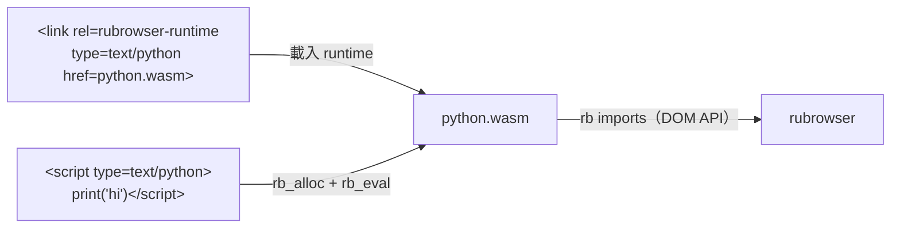

# 加入新的腳本語言

rubrowser 只執行 WebAssembly。任何語言只要有一個**編成 wasm 的直譯器**（runtime），就能在網頁中使用，瀏覽器本身不需要修改。JavaScript 就是這樣支援的（見 [javascript.md](javascript.md)）。



## 1. 網頁怎麼使用

```html
<link rel="rubrowser-runtime" type="text/python" href="python.wasm">

<p id="out"></p>
<script type="text/python">
  # 交給 python.wasm 執行
</script>
<script type="text/python" src="app.py"></script>
```

- `<link rel="rubrowser-runtime">` 宣告某個 MIME type 的 runtime；它會在所有 `<script>` 之前載入。
- 之後 `type` 相同的 `<script>`（內嵌或 `src`）依文件順序交給這個 runtime 執行。
- 同一頁、同一種語言共用一個 runtime instance，所以腳本之間能共享全域狀態。
- 沒有 runtime 的 `type` 會被略過，並在主控台記錄 `no runtime for scripts of type …`。

### 選擇 runtime 的順序

| `<script type>` | runtime |
|---|---|
| `application/wasm` | 不需要 runtime，直接執行該 wasm 模組 |
| 空白、`text/javascript`、`module` 等 | 內建的 `js.wasm`（boa） |
| 其他（例如 `text/python`） | 該頁 `<link rel="rubrowser-runtime" type="…">` 宣告的 runtime |

網頁宣告的 runtime 優先於內建 runtime；例如網頁可以為 `text/javascript` 換上自己的 JS 引擎。

## 2. runtime 要實作什麼

runtime 是一個一般的 rubrowser wasm 模組（見 [abi.md](abi.md)），另外再匯出兩個函式：

| 匯出 | 說明 |
|---|---|
| `memory` | 線性記憶體 |
| `rb_alloc(len: i32) -> i32` | 配置 `len` 位元組並回傳位址；瀏覽器把原始碼與檔名寫進去 |
| `rb_eval(src: i32, src_len: i32, name: i32, name_len: i32)` | 執行一段原始碼（UTF-8）；`name` 是網址或 `… (inline script)`，用於錯誤訊息 |
| `rb_init()`（可選） | 載入時呼叫一次，用來建立直譯器 |
| `rb_event(listener: i32)`、`rb_timer(id: i32)`（可選） | 把事件與計時器轉給該語言的處理函式 |

runtime 透過 `rb` imports 操作 DOM：查詢元素、修改文字與屬性、登記事件（`listen`）、計時器（`set_timeout`）、輸出主控台（`log`）等。

### 限制

runtime 的沙箱上限比一般 wasm 腳本寬：

| 限制 | 一般 wasm 腳本 | runtime |
|---|---|---|
| 每次呼叫的 fuel | 3,000 萬條指令 | 20 億條指令 |
| 記憶體 | 64 MiB | 512 MiB |

## 3. 最小範例

以下用 WebAssembly 文字格式寫一個玩具語言 `text/x-shout`，它的「直譯器」只做一件事：把原始碼放進 `#out`。

```wat
(module
  (import "rb" "query" (func $query (param i32 i32) (result i32)))
  (import "rb" "set_text" (func $set_text (param i32 i32 i32)))
  (memory (export "memory") 1)
  (data (i32.const 0) "#out")
  (global $next (mut i32) (i32.const 1024))
  (func (export "rb_alloc") (param $len i32) (result i32)
    (local $p i32)
    (local.set $p (global.get $next))
    (global.set $next (i32.add (global.get $next) (local.get $len)))
    (local.get $p))
  (func (export "rb_eval") (param $src i32) (param $len i32) (param i32 i32)
    (call $set_text (call $query (i32.const 0) (i32.const 4))
                    (local.get $src) (local.get $len))))
```

這個例子在 `src/browser/mod.rs` 的測試 `page_provided_language_runtime` 中實際執行。

## 4. 用 Rust 寫 runtime

實際的語言通常是把現成的 Rust 直譯器編成 wasm，作法和 `src/lang/js.rs` 相同：

1. 依賴 `rubrowser`（`sdk` feature）與直譯器 crate。
2. 用 `rubrowser::sdk` 的函式（或 `sdk::ffi` 這一層）把 DOM 操作提供給該語言。
3. 匯出 `rb_alloc`、`rb_eval`、`rb_event`、`rb_timer`。
4. 若直譯器需要時間或亂數：時間用 `sdk::now()` / `sdk::wall_time()`；亂數可用 `getrandom` 的 custom backend（見 `.cargo/config.toml`）。
5. 以 `cargo build --release --target wasm32-unknown-unknown` 編譯，產生的 `.wasm` 就是 runtime。

例如 [RustPython](https://github.com/RustPython/RustPython) 可以照這個方式編成 `python.wasm`。若要讓某種語言**內建**在瀏覽器中，就在 `builtin_runtime`（`src/browser/mod.rs`）加入它的 MIME type 與 wasm。
