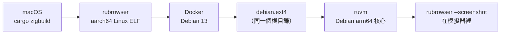

# Linux 版

rubrowser 可以在 Linux 上執行：視窗版用 winit + softbuffer（X11 或 Wayland），`--screenshot` 不需要顯示器。本文說明如何從 macOS 交叉編譯、在 Docker 的 Debian 13 裡測試，以及在 [ruvm](https://github.com/ccc-claude-opus/ruvm)（自己寫的 AArch64 模擬器）裡開機進入同一個 Debian、再在裡面執行 rubrowser。



## 1. 交叉編譯

```bash
rustup target add aarch64-unknown-linux-gnu
cargo install cargo-zigbuild
scripts/linux/build.sh            # 或 scripts/linux/build.sh x86_64
```

還需要 [zig](https://ziglang.org/download/)：依賴裡的 `ring` 會編譯 C 程式碼，macOS 的 clang 沒有 Linux 的標頭檔與連結器，zig 提供這兩者。輸出在 `target/aarch64-unknown-linux-gnu/release/rubrowser`（約 30 MB，動態連結 glibc）。

在 Linux 上直接 `cargo build --release` 也可以，需要 C 編譯器（gcc）。`media` feature 另外需要 FFmpeg 8 與 ALSA 的開發套件（`libavcodec-dev` 等、`libasound2-dev`）。

## 2. Debian 13（Docker）

```bash
scripts/linux/docker-test.sh
```

映像（`scripts/linux/Dockerfile`）是 `debian:trixie-slim` 加上 CA 憑證、Liberation 字型（與 Arial / Georgia 等寬）、文泉驛微米黑（中文），以及 X11 函式庫與 Xvfb。腳本截下兩個測試網頁與一個 HTTPS 網頁，再在虛擬顯示器上開視窗版，用 `xwd` 截下整個畫面。圖片在 `target/linux/`。

執行時需要的系統套件：glibc；視窗版另需 libX11、libxcb、libXcursor、libXrandr、libXi、libxkbcommon（一般桌面都有）。字型依序找系統的 Liberation / Noto / 文泉驛等（路徑見 `src/text/mod.rs`），找不到時用內附的 DejaVu。

## 3. 在 ruvm 裡

```bash
scripts/linux/ruvm-root.sh                          # target/linux/debian.ext4
scripts/linux/ruvm-boot.sh ~/path/to/ruvm           # 開機、截圖、關機
```

`ruvm-root.sh` 把 Docker 映像的根目錄（`docker export`）在 Linux 容器裡以 root 做成 1 GiB 的 ext4，檔案擁有者與大小寫都保留，再放進 rubrowser、測試網頁，以及 `scripts/linux/init` 作為 `/sbin/init`。

`ruvm-boot.sh` 用 ruvm 開機：Debian 原版的 arm64 核心（6.12）與 ruvm 的 initramfs（載入 ext4 與 virtio 模組，掛上 `/dev/vda` 後 `switch_root`）。`init` 印出系統版本、執行幾個 Debian 的動態連結程式，對兩個測試網頁各執行一次 `rubrowser --screenshot`，寫到磁碟後以 sysrq 關機；腳本再用 `debugfs` 把截圖取出到 `target/linux/ruvm-*.png`。

ruvm 不需要修改：Debian 的 glibc、bash、coreutils、dpkg，以及 rubrowser（含 wasmtime 的 Cranelift JIT 在模擬的 CPU 上產生並執行機器碼）都正常執行，截圖與原生執行的結果相同。

## 4. 量測（2026-11-18，M3 iMac）

| 項目 | 時間 |
|---|---|
| 交叉編譯（release，第一次） | 9 分 23 秒 |
| Docker：靜態網頁 / JS 網頁 | 0.5 秒 / 1.1 秒 |
| Docker：en.wikipedia.org/wiki/Linux | 6.7 秒 |
| ruvm：開機到 `/sbin/init` | 約 13 億條指令（客體時間 134 秒） |
| ruvm：靜態網頁 | 客體時間 278 秒 |
| ruvm：JS 網頁（含 Cranelift 編譯 `js.wasm`） | 客體時間 5,746 秒 |
| ruvm：整個流程（開機、兩頁、關機） | 實際 9 分 38 秒，約 617 億條指令（每秒約 1.07 億條） |

ruvm 的時鐘每條指令前進一格（以 10 MHz 計），所以客體時間是「指令數 ÷ 1000 萬」，不是實際經過的時間。JS 網頁慢，是因為 wasmtime 第一次要在模擬的 CPU 上把 6.6 MB 的 `js.wasm` 編成機器碼。
