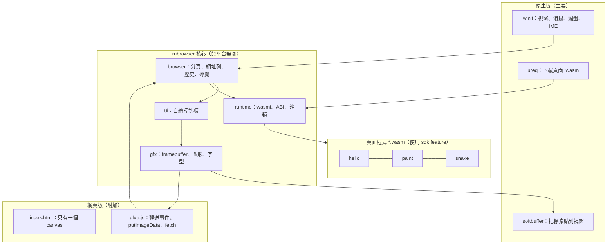

# rubrowser 開發規劃

rubrowser 是一個用 Rust 寫的瀏覽器。它不跑 HTML / JavaScript，跑的是 **用 Rust 寫、編譯成 WebAssembly 的頁面程式**。

整個瀏覽器只有一塊「畫板」（像素緩衝區），網址列、分頁、按鈕、捲軸等所有控制項都由 Rust 自己畫出來，並自己處理滑鼠與鍵盤。

## 1. 已確定的決策

| 項目 | 決定 |
|---|---|
| 名稱 | `rubrowser`，發佈到 crates.io |
| Crate 數量 | **只有一個 crate**，用 features 區分用途 |
| 主要版本 | **原生版**：`cargo install rubrowser` 後直接執行 |
| 附加版本 | 網頁 canvas 版：瀏覽器編成 wasm，在 `<canvas>` 上執行 |
| 執行頁面 wasm | 內嵌 `wasmi`（純 Rust 直譯器），兩個版本共用 |
| 繪圖 | 自寫軟體繪圖，輸出 `&[u32]` 像素陣列 |
| 字型 | 第一版內嵌 8×16 點陣 ASCII 字型；之後再用 `fontdue` 支援中文 |
| UI | 自寫 immediate-mode 控制項 |
| 授權 | MIT |

## 2. 架構



核心對外只有兩個介面：

- **輸入**：滑鼠、鍵盤、視窗尺寸等事件
- **輸出**：一個 `width × height` 的 `u32` 像素陣列（`0x00RRGGBB`）

所以兩種平台都只需要一層很薄的轉接。

## 3. 依賴套件

| 套件 | 版本 | 用途 | feature |
|---|---|---|---|
| `wasmi` | 2.x | 執行頁面 wasm | `core` |
| `winit` | 0.30 | 視窗、輸入、IME | `native` |
| `softbuffer` | 0.4 | 把像素貼到視窗 | `native` |
| `ureq` | 3.x | HTTP 下載頁面 | `native` |
| `arboard` | 3.x | 剪貼簿（可選） | `native` |
| `fontdue` | 0.9 | TTF 字型（第二階段） | `core` |

網頁版**不使用** wasm-bindgen / web-sys，只用 `extern "C"` 匯出函式，再加一個手寫的 `glue.js`。

`sdk` feature **沒有任何依賴**。

## 4. 專案結構

```
rubrowser/
├─ Cargo.toml
├─ src/
│  ├─ lib.rs          # 依 feature 決定要編進哪些模組
│  ├─ main.rs         # 原生執行檔（需要 native feature）
│  ├─ gfx/            # framebuffer、圖形、點陣字型
│  ├─ ui/             # 自繪控制項
│  ├─ runtime/        # wasmi 包裝、ABI、沙箱
│  ├─ browser/        # 分頁、網址列、歷史、導覽
│  ├─ platform/
│  │  ├─ native.rs    # winit + softbuffer
│  │  └─ web.rs       # extern "C" 匯出給 glue.js
│  └─ sdk/            # 頁面作者用的 API
├─ examples/          # 範例頁面：hello、links、paint、calc、snake
├─ web/               # index.html + glue.js
├─ assets/            # 預先編好的範例頁面 .wasm（打包進原生版當內建首頁）
├─ scripts/build.sh   # 編譯網頁版與範例頁面
└─ doc/
```

### Cargo features

```toml
[features]
default = ["native"]
sdk     = []
core    = ["dep:wasmi"]
native  = ["core", "dep:winit", "dep:softbuffer", "dep:ureq"]
web     = ["core"]

[lib]
crate-type = ["rlib", "cdylib"]

[[bin]]
name = "rubrowser"
required-features = ["native"]

[[example]]
name = "hello"
crate-type = ["cdylib"]
required-features = ["sdk"]
```

### 使用方式

| 用途 | 指令 |
|---|---|
| 安裝原生版 | `cargo install rubrowser` |
| 開啟頁面 | `rubrowser https://example.com/hello.wasm` |
| 開啟本機頁面 | `rubrowser ./hello.wasm` |
| 編譯網頁版 | `cargo build --lib --target wasm32-unknown-unknown --no-default-features --features web` |
| 編譯範例頁面 | `cargo build --example hello --target wasm32-unknown-unknown --no-default-features --features sdk` |
| 寫自己的頁面 | `rubrowser = { version = "0.1", default-features = false, features = ["sdk"] }` |

## 5. 頁面程式介面（ABI v0）

### 頁面匯出（export）

| 函式 | 說明 |
|---|---|
| `rb_init()` | 載入後呼叫一次 |
| `rb_frame(w: i32, h: i32, t_ms: f64)` | 每幀呼叫一次，頁面在此繪圖 |
| `rb_event(kind: i32, a: i32, b: i32, c: i32)` | 滑鼠與鍵盤事件，座標已轉成頁面座標 |

### 瀏覽器提供（import，模組名 `rb`）

| 函式 | 說明 |
|---|---|
| `clear(color)` | 清除內容區 |
| `fill_rect(x, y, w, h, color)` | 填滿矩形 |
| `line(x0, y0, x1, y1, color)` | 畫線 |
| `draw_text(ptr, len, x, y, size, color)` | 畫 UTF-8 文字（用瀏覽器的字型） |
| `text_width(ptr, len, size) -> i32` | 量測文字寬度 |
| `blit(ptr, w, h, x, y)` | 直接貼上一塊像素 |
| `navigate(ptr, len)` | 開啟連結（可為相對網址） |
| `set_title(ptr, len)` | 設定分頁標題 |
| `log(ptr, len)` | 輸出除錯訊息 |
| `request_redraw()` | 要求下一幀重畫 |
| `now() -> f64` | 目前時間（毫秒） |

### SDK 寫法

```rust
use rubrowser::sdk::*;

struct App { clicks: u32 }

impl Page for App {
    fn frame(&mut self, g: &mut Gfx) {
        g.clear(0x202020);
        g.text(20, 20, 16, "Hello rubrowser", 0xffffff);
    }
    fn event(&mut self, e: Event) {
        if let Event::MouseDown { .. } = e { self.clicks += 1; }
    }
}

page!(App { clicks: 0 });
```

### 沙箱

- 用 wasmi 的 **fuel** 限制每次呼叫可執行的指令數，避免無窮迴圈卡住瀏覽器。
- 限制頁面的線性記憶體上限。
- 頁面 trap 或超時時，只顯示錯誤頁，瀏覽器本身不受影響。
- 頁面只能透過上述 import 和外界互動，無法存取檔案或網路。

## 6. 里程碑

| 階段 | 內容 | 完成條件 |
|---|---|---|
| **M0** 骨架 | `Cargo.toml`（含發佈資訊與 features）；原生版開視窗、填滿單色；網頁版在 canvas 填滿單色 | 兩個版本都能顯示畫面，`cargo publish --dry-run` 通過 |
| **M1** 繪圖 | 矩形、線、裁切區、點陣字型、高 DPI 縮放 | 畫出靜態的瀏覽器外框 |
| **M2** UI 與輸入 | 按鈕（hover / 按下）、文字框（游標、選取、方向鍵、Backspace、剪貼簿）、焦點與 Tab 切換、分頁列 | 網址列可以輸入與編輯 |
| **M3** 執行頁面 | wasmi 載入頁面，ABI v0，SDK，`examples/hello` | 輸入網址後顯示 hello 頁面並能點擊互動 |
| **M4** 瀏覽 | `navigate`、上一頁 / 下一頁 / 重新整理、多分頁、載入中與錯誤頁、內建首頁 | 在多個範例頁面之間跳轉 |
| **M5** 沙箱與範例 | fuel、記憶體上限；範例 paint、calc、snake | 寫一個無窮迴圈的頁面也不會卡住瀏覽器 |
| **M6** 文件 | `doc/` 架構說明、ABI 規格、頁面撰寫教學；README | 新使用者能照文件寫出自己的頁面 |
| **M7** 發佈 | 版本號、`cargo publish --dry-run`、CI | 交給作者執行 `cargo publish` |

## 7. 已知風險

- **中文輸入**：原生版可用 winit 的 IME 事件實作（M2 之後）；網頁版因為只有 canvas，暫不支援。
- **中文顯示**：需要中文字型，檔案較大，第二階段再處理（例如字型子集或讀系統字型）。
- **效能**：wasmi 是直譯器，比 JIT 慢，但畫 UI 與小遊戲足夠；畫面只在有變動時重畫。
- **發佈時的 wasm 檔**：`assets/` 中預先編好的範例頁面要和原始碼一起提交，並注意 crates.io 單一 crate 10 MB 的上限。
