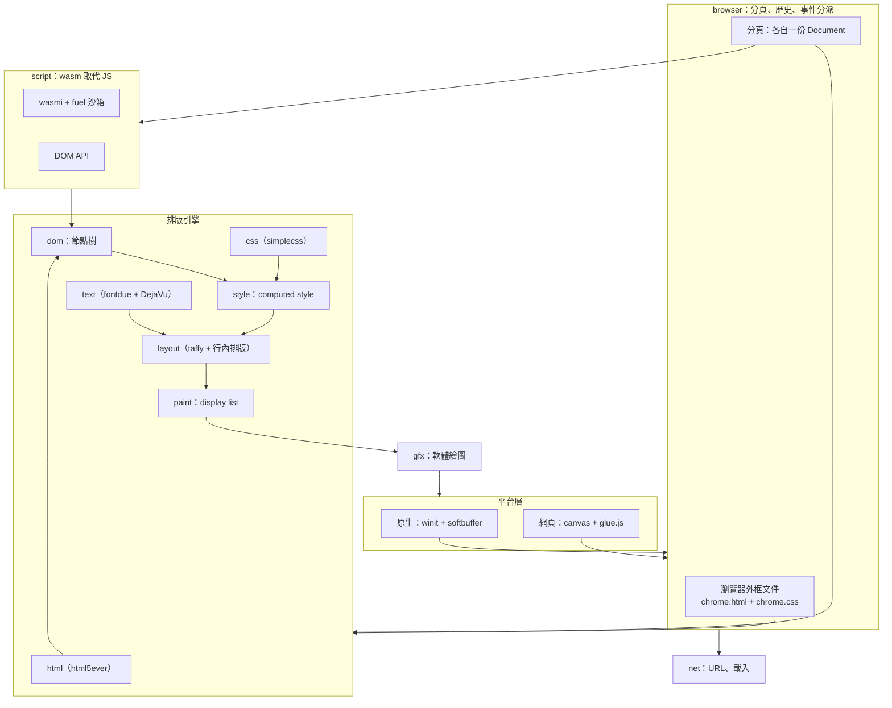
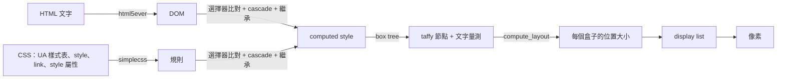

# rubrowser 開發規劃

> 第二階段（JavaScript、DOM、更完整的 HTML）見 [plan2.md](plan2.md)。

rubrowser 是一個用 Rust 寫的瀏覽器，畫在**一塊空白畫布**上（原生視窗的像素緩衝區，或網頁上的單一 `<canvas>`）。

- 網頁使用 **HTML + CSS**，由 rubrowser 自己排版、自己畫。
- **不支援 JavaScript**，網頁的行為改用 **WebAssembly**（例如 Rust 編成的 wasm）撰寫。
- 瀏覽器本身的控制項（網址列、分頁、按鈕）**也是一份 HTML + CSS 文件**，和網頁共用同一套引擎。

## 1. 已確定的決策

| 項目 | 決定 |
|---|---|
| 名稱 | `rubrowser`，發佈到 crates.io，**只有一個 crate** |
| 主要版本 | 原生版（`winit` + `softbuffer`），`cargo install rubrowser` |
| 附加版本 | 網頁 canvas 版（編成 wasm，`extern "C"` + `glue.js`） |
| HTML 解析 | `html5ever`，透過 `TreeSink` 直接建立 rubrowser 自己的 DOM |
| CSS 解析與選擇器 | `simplecss`（CSS 2 選擇器、specificity），顏色用 `csscolorparser` |
| 排版 | `taffy`（block、flex），行內文字排版自己寫，作為 taffy 的量測葉節點 |
| 字型 | `fontdue` 繪製字形，字型用 `dejavu` crate 內附的 DejaVu Sans / Bold / Mono |
| 腳本 | `wasmi` 執行網頁的 wasm，有 fuel 與記憶體上限 |
| 介面語言 | 先做英文介面；中文顯示列為後期 |
| 授權 | MIT（DejaVu 字型為 Bitstream Vera 授權，可隨程式散佈） |

## 2. 架構



### 一份文件的處理流程



### 瀏覽器外框也是 HTML

- `chrome.html` 裡有網址列 `<input>`、分頁、按鈕，以及一個佔位元素 `<div id="viewport">`。
- 引擎先排版外框，再把目前分頁的 Document 畫進 `#viewport` 的矩形範圍。
- 外框的行為第一版用 Rust 內建程式碼，透過**和網頁 wasm 相同的 DOM 操作**控制外框文件。

## 3. wasm 取代 JavaScript

```html
<button id="inc">+1</button> <span id="count">0</span>
<script type="application/wasm" src="counter.wasm"></script>
```

```rust
use rubrowser::sdk::*;

fn init() {
    let count = query("#count").unwrap();
    let mut n = 0;
    query("#inc").unwrap().on("click", move |_| {
        n += 1;
        count.set_text(&n.to_string());
    });
}

rubrowser::script!(init);
```

| 項目 | 設計 |
|---|---|
| 節點參照 | 整數 handle |
| DOM API | `query`、`query_all`、`text` / `set_text`、`attr` / `set_attr`、`add_class` / `remove_class`、`set_style`、`create_element`、`append`、`remove`、`value` / `set_value` |
| 事件 | `on("click", 閉包)` 登記，事件冒泡；瀏覽器呼叫 wasm 匯出的 `rb_event` |
| 其他 | `navigate`、`log`、`set_timeout` |
| 沙箱 | 每次呼叫有 fuel 上限、記憶體上限；崩潰只影響自己的分頁 |

完整 ABI 寫在 [abi.md](abi.md)，教學在 [scripting.md](scripting.md)，架構說明在 [architecture.md](architecture.md)。

## 4. HTML / CSS 支援範圍（第一版）

**HTML**：html5ever 處理完整的 HTML5 語法。排版支援的元素有 `div span p h1–h6 a ul ol li br hr pre code b i strong em input button`；`style`、`link`、`script`、`title` 有特別處理。暫不支援 `img`、`table`、`form` 送出。

**CSS**

| 類別 | 屬性 |
|---|---|
| 選擇器 | `*`、標籤、`.class`、`#id`、`[attr]`、後代、`>`、`+`、`:hover` `:active` `:focus` `:first-child` |
| display | `block` `inline` `inline-block` `flex` `none` |
| 盒模型 | `margin` `padding` `border`（solid）`width` `height` `min-*` `max-*` `box-sizing` |
| 文字 | `color` `font-size` `font-weight` `font-family`（sans / monospace）`line-height` `text-align` `white-space` `text-decoration` |
| 背景 | `background-color`、`background` 的顏色部分 |
| Flex | `flex-direction` `flex-wrap` `justify-content` `align-items` `align-self` `gap` `flex` `flex-grow` `flex-shrink` `flex-basis` |
| 其他 | `overflow`（hidden / auto / scroll）`cursor` |
| 單位 | `px` `em` `rem` `%` |
| 顏色 | 顏色名稱、`#hex`、`rgb()`、`rgba()`（alpha 混色） |

## 5. 模組結構

```
src/
├─ gfx/       軟體繪圖：framebuffer、裁切、blit、alpha 混色
├─ text/      fontdue、字型、量測、字形快取
├─ dom/       節點樹（arena + NodeId）、html5ever TreeSink
├─ css/       樣式表、選擇器比對、cascade、值的解析
├─ layout/    box tree、taffy、行內排版
├─ paint/     display list → gfx
├─ document/  把上面串成一份可互動的 Document（hover、focus、捲動、hit-test）
├─ script/    wasmi 執行網頁 wasm、DOM API
├─ net/       URL、載入
├─ ui/        TextField（<input> 的編輯邏輯）
├─ browser/   外框文件、分頁、歷史
├─ platform/  native.rs、web.rs
└─ sdk/       網頁 wasm 用的 API
```

## 6. 里程碑

| 階段 | 內容 | 完成條件 | 狀態 |
|---|---|---|---|
| M0 | 單一 crate 骨架，原生與網頁版都能顯示畫面 | `cargo publish --dry-run` 通過 | ✅ |
| M1 | 軟體繪圖、點陣字、高 DPI | 畫出靜態外框 | ✅ |
| 基礎 | 輸入事件、URL、TextField、wasm 執行環境 | 單元測試通過 | ✅ |
| **H1** 文字 | fontdue、DejaVu、量測、字形快取 | 畫出不同大小、粗細的比例字 |✅ |
| **H2** DOM + HTML | 自己的 DOM、html5ever TreeSink | 解析 HTML 得到正確 DOM 樹 |✅ |
| **H3** CSS | UA 樣式表、選擇器比對、cascade、繼承、值解析 | 每個節點算得出 computed style |✅ |
| **H4** 排版 + 繪製 | box tree、taffy、行內排版、背景、邊框、文字 | `rubrowser page.html` 畫出靜態網頁 |✅ |
| **H5** 互動 | hit-test、`:hover` `:active` `:focus`、連結、捲動 | 點擊連結能換頁 |✅ |
| **H6** HTML 外框 | `chrome.html` / `chrome.css`、分頁、歷史、載入 http / file | 整個瀏覽器由 HTML + CSS 畫出 |✅ |
| **H7** 表單 | `<input>` 編輯、`<button>`、Tab 切換焦點 | 網址列可完整編輯 |✅ |
| **H8** wasm 腳本 | `<script type="application/wasm">`、DOM API、SDK、範例 | counter、todo 範例可運作 |✅ |
| **H9** 收尾 | 網頁 canvas 版、文件、`cargo publish --dry-run` | 交給作者發佈 |✅ |
| 後期 | `img`、`table`、`position`、`border-radius`、中文字型、IME | | |

## 7. 已知風險

- **相容性**：只支援上面列出的子集，一般網站不會正確顯示；目標是「為 rubrowser 寫的網頁」。
- **行內排版**：taffy 不處理文字，行內排版（斷行、混合樣式）要自己寫，是最複雜的部分。
- **效能**：純軟體繪製；只在有變動時重新排版與重畫。
- **中文**：DejaVu 沒有中文字形，第一版中文會顯示成方框。
