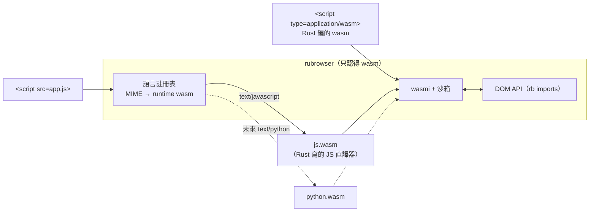

# rubrowser 第二階段規劃

第一階段（[plan.md](plan.md)）完成了 HTML + CSS 引擎、HTML 外框和 Rust wasm 腳本。第二階段目標：

1. **支援 JavaScript，但一律以 wasm 執行**：瀏覽器本身只執行 wasm；以後要加 Python 等語言時，走同一條路。
2. **完整的 DOM**，讓 wasm（以及其中執行的 JS）能操控網頁。
3. **更完整的 HTML**：圖片、表格、表單等。

## 1. 「JS 轉成 wasm 再執行」怎麼做

JS 是動態語言，直接編譯成 wasm 還需要一個在 wasm 裡的執行環境（物件模型、GC、內建函式）。業界常見做法（例如 Shopify 的 Javy）是：**把 JS 引擎本身編成 wasm，JS 原始碼交給這個 wasm 執行**。rubrowser 採用同樣的架構：

- **語言 runtime 也是 wasm 模組**，和 Rust 編的網頁腳本用完全相同的 `rb` DOM API、相同的 fuel / 記憶體沙箱。
- 瀏覽器載入 `<script src="app.js">` 時：取得 runtime `js.wasm`（內建），建立 instance，再把 JS 原始碼交給它（`rb_eval(ptr, len)`）。
- 新增語言只要提供一個實作 runtime 協定的 wasm（見第 4 節），瀏覽器本身不用改。

### JS 引擎的選擇

| 選項 | 結論 |
|---|---|
| 自己寫 JS 直譯器 | 只能支援子集，工作量大 |
| QuickJS（C）編成 wasm | 需要 C 的 wasm 工具鏈 |
| **`boa_engine`（純 Rust）編成 wasm** ✅ | 標準完整（ES2023+），實測可行 |

**決定：使用 `boa_engine`**，編成 `js.wasm` runtime。實測（`wasm32-unknown-unknown`，在 wasmi 中執行）：

| 測試 | 時間 |
|---|---|
| 建立引擎 + `1+2` | 7 ms |
| 一萬次迴圈 | 17 ms |
| 1000 個 class 實例 + map / filter / reduce | 38 ms |
| JSON 往返 | 2.5 ms |

- wasm 大小約 4.4 MB，**沒有任何 import**（不需要 wasm-bindgen）。
- 在沒有作業系統的 wasm 中，boa 需要的時間與亂數由 runtime 自己提供：時間用自訂 `Clock`（向瀏覽器的 `now` 取得），亂數用 `getrandom` 的 custom backend。
- runtime 的 Rust 程式碼放在 `src/lang/js.rs`，由 feature `js-runtime`（相依 `boa_engine`）啟用，只在建置 `js.wasm` 時編譯；一般使用者安裝 rubrowser 不會編譯 boa。
- 編好的 `js.wasm` 和範例頁的 wasm 一樣提交進 repo，並打包進瀏覽器。

以後的 Python 走同樣的路（例如 RustPython 編成 `python.wasm`）。

### JS 中可用的瀏覽器 API（第一版）

`document`（`getElementById`、`querySelector(All)`、`createElement`、`createTextNode`、`body`、`title`）、元素（`textContent`、`innerHTML`、`id`、`className`、`classList`、`style`、`value`、`getAttribute` 等、`appendChild`、`insertBefore`、`remove`、`children`、`parentElement`、`addEventListener`）、事件物件（`type`、`target`、`key`、`preventDefault`、`stopPropagation`）、`setTimeout` / `setInterval` / `clear*`、`console.log`、`location.href`。

## 2. DOM API v1（ABI v1）

目前的 ABI v0 只有查詢與基本修改。v1 補齊 JS 常用的 DOM 能力，Rust SDK 同步擴充：

| 類別 | 新增 |
|---|---|
| 節點導覽 | `node_type`、`tag_name`、`first_child` `last_child` `next_sibling` `prev_sibling`、`child_count` / `child_at`、`document_element` `body` `head` |
| 內容 | `get_inner_html` / `set_inner_html`（html5ever 片段解析）、`get_outer_html` |
| 屬性 | `attr_names`、`has_attr` |
| 版面 | `get_rect`（元素在頁面上的位置與大小） |
| 事件 | 事件物件欄位（type、key 字串、座標、按鈕、修飾鍵）、`stop_propagation`、`unlisten`；新增 `mousedown` `mouseup` `mouseover` `mouseout` `dblclick` `focus` `blur` `submit` |
| 計時器 | `clear_timeout` |
| 文件 | `get_title` / `set_title`、`location` 讀取、`history_back` |

`rb_event(listener, target, …)` 改為只傳 listener 與事件 id，其餘欄位用 `event_*` imports 在處理期間查詢，之後新增欄位不必改簽名。

## 3. 更完整的 HTML / CSS

| 項目 | 做法 |
|---|---|
| `` | `image` crate 解碼 PNG / JPEG / GIF / WebP / BMP；`width` / `height` 屬性與 CSS 尺寸、等比例縮放、`alt` 文字；載入中保留尺寸 |
| `<table>` | 轉成 taffy 的 **CSS Grid**：每列一個 grid row，`colspan` / `rowspan` 對應 grid span；`<caption>`、`<thead>` `<tbody>` `<tfoot>`、`border-collapse` 簡化處理、儲存格 `vertical-align` |
| 表單 | `<textarea>`（多行編輯）、`checkbox` / `radio`、`<select>`（自繪下拉選單）、`<label for>`、`<form>` 以 GET 送出、`submit` 事件 |
| CSS | `float`（taffy float layout）、`position: fixed`、`z-index`、`opacity`、`border-style: dashed / dotted`、`vertical-align`（`sup` `sub` `middle`）、`text-transform`、`letter-spacing`、`background-image: url()`、`outline` |
| 其他元素 | `` `` `<mark>` `<kbd>` `
` / `
`、`<blockquote>`、`<dl>`、`<figure>`、`<meta charset>`、`<base href>` |

## 4. 語言 runtime 協定（為 Python 等語言預留）

一個語言 runtime 是一個 wasm 模組，除了 ABI 的一般匯出，再多匯出：

| 匯出 | 說明 |
|---|---|
| `rb_alloc(len) -> ptr` | 讓瀏覽器把原始碼寫進 runtime 的記憶體 |
| `rb_eval(ptr, len, name_ptr, name_len)` | 執行一段原始碼（`name` 是檔名，用於錯誤訊息） |

瀏覽器以 MIME type 選擇 runtime：

| `<script type>` | runtime |
|---|---|
| `application/wasm` | 直接執行該 wasm |
| 省略、`text/javascript`、`module` | 內建 `js.wasm` |
| `text/python`（未來） | `python.wasm` |

同一頁的同一種語言共用一個 runtime instance，所以多個 `<script>` 共享全域變數（和瀏覽器的 JS 行為一致）。

網頁也能用 `<link rel="rubrowser-runtime" type="…" href="….wasm">` 自備 runtime，詳見 [languages.md](languages.md)。

## 5. 里程碑

| 階段 | 內容 | 完成條件 |
|---|---|---|
| **D1** DOM API v1 | ABI v1、事件物件、innerHTML、導覽、更多事件；Rust SDK 與文件更新 | 單元測試；現有範例照常運作 ✅ |
| **J1** JS runtime | boa 編成 `js.wasm`、runtime 協定（`rb_eval`）、時間與亂數 | 在瀏覽器中執行 `console.log` 與計算 ✅ |
| **J2** JS DOM 綁定 | `document`、元素、事件、計時器；`<script>`（內嵌與外部）、`onclick` 等屬性、JS 版範例 | JS 版 todo 在瀏覽器中運作 ✅ |
| **H10** 圖片 | `` 解碼、尺寸、載入 | 範例頁顯示 PNG / JPEG / GIF ✅ |
| **H11** 表格 | grid 對應、span、表頭表尾 | 表格範例排版正確 ✅ |
| **H12** 表單 | textarea、checkbox、radio、select、label、form 送出 | 表單範例可操作 ✅ |
| **H13** CSS 與元素補完 | float、fixed、z-index、opacity 等 | 展示頁 ✅ |
| **L1** 語言 runtime 協定 | MIME 註冊表、`rb_eval` 協定、新增語言教學 | 文件與測試 ✅ |

每個里程碑完成後各自 commit。
