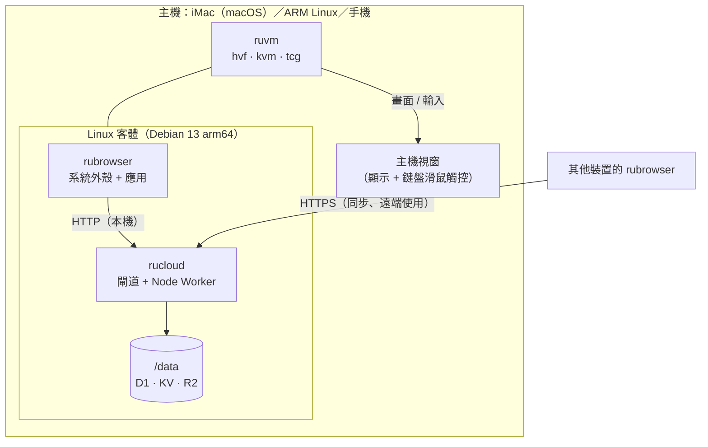

# 以瀏覽器為介面的手機＋桌機系統：後續規劃

目標：把四個專案串成一個完整的系統，使用者看到的只有瀏覽器，同一套應用在桌機（iMac）和手機上都能用。

| 專案 | 在系統中的角色 |
|---|---|
| [ruvm](https://github.com/ccc-claude-opus/ruvm) | 虛擬機：在 iMac（Hypervisor.framework）、ARM Linux（KVM）上以原生速度執行系統；其他平台用直譯器 |
| Linux（Debian 13 arm64） | 核心、驅動、檔案系統、網路；使用者不直接接觸 |
| [rucloud](https://github.com/ccc-claude-opus/rucloud) | 應用伺服器與系統服務：每個應用是一個 Worker，資料放 D1 / KV / R2 / Durable Objects，排程用 Cron / Queues |
| [rubrowser](https://github.com/ccc-claude-opus/rubrowser) | 唯一的使用者介面：系統外殼（主畫面、切換應用、設定）和應用本身都是網頁 |



## 0. 現況（2026-11-18 已驗證）

整條路已經打通，只是畫面還在主機這邊：

| 環節 | 結果 |
|---|---|
| ruvm `-accel hvf`（v1.2） | Debian 13 開機到 shell 約 1 秒；4 vCPU |
| ruvm `-accel kvm` | 在 QEMU 模擬的 EL2 Linux 裡通過開機、重開機、關機（[ruvm tools/linux/kvm-test.sh](https://github.com/ccc-claude-opus/ruvm/blob/main/tools/linux/kvm-test.sh)） |
| rubrowser 在 ruvm 的 Linux 裡 | 截圖與原生相同；開機、兩頁、關機共 4.4 秒（[linux.md](linux.md)） |
| rucloud 在 ruvm 的 Linux 裡 | Debian 13 + Node 24：開機到 D1 範本應用就緒 2.6 秒，Worker、D1 讀寫正常（`scripts/linux/rucloud-ruvm.sh`） |
| iMac 上的 rubrowser 開啟 VM 裡的 rucloud 應用 | 透過 ruvm 的 hostfwd（`http://127.0.0.1:18787/`），畫面與互動正常 |

```bash
scripts/linux/rucloud-ruvm.sh ~/path/to/ruvm ~/path/to/rucloud     # VM 裡的 rucloud，轉到本機 18787
rubrowser http://127.0.0.1:18787/
```


## 1. 需要您先決定的事

| 問題 | 選項 | 建議 |
|---|---|---|
| rubrowser 跑在哪裡 | (a) 主機上，連到 VM 裡的 rucloud（現在就能用）；(b) VM 裡，ruvm 提供螢幕與輸入（真正的「整個系統在 VM 裡」） | 先 (a) 讓系統可用，同時做 (b)；(b) 完成後 (a) 仍保留作「遠端使用」 |
| 「手機」指什麼 | (a) 先在桌機上以手機尺寸與觸控模擬；(b) 實體 ARM Linux 手機（例如 postmarketOS 支援的機型，有些有 KVM）；(c) Android / iOS 上的 App | 先 (a)；實體裝置等外殼成熟再選，(c) 牽涉商店上架與平台限制，最後再談 |
| 整合放哪個 repo | 新開一個整合專案（映像建置、啟動器、外殼網頁）；或放在 rubrowser 裡 | 新開一個，四個元件保持獨立，各自可單獨使用與發布 |
| 系統的 Linux | 繼續用 Debian 13（套件齊全，約 300 MB）；或自訂最小系統（busybox + 必要函式庫，開機更快、映像更小） | 先 Debian；等元件固定後再精簡 |

## 2. 階段規劃

每個階段都有可驗證的完成條件，做完一個再做下一個。

### 階段 1：一鍵啟動的系統映像（主機上的瀏覽器）

把現在手動串起來的東西變成一個指令。

* **映像建置**：Debian 13 + Node 24 + rucloud + rubrowser（Linux 版）+ 預裝應用，產生唯讀的系統碟 `system.ext4` 和可寫的資料碟 `data.ext4`。系統碟用 `-snapshot` 掛載，更新時整顆替換（像手機的系統更新），使用者資料只在資料碟。
* **init**：不用 systemd；一個小 init 啟動網路、rucloud（`rucloud serve`，多應用設定檔）、看門狗。
* **啟動器**：一個指令完成 ruvm 選擇加速器（hvf → kvm → tcg）、開機、等 rucloud 就緒、開 rubrowser 到入口網站。rucloud 已有 `sites/webportal`，可以當第一版主畫面。
* **網路**：ruvm 的使用者模式網路 + hostfwd；對外連線（應用抓資料）已可用。
* **完成條件**：一個指令在 10 秒內，從關機狀態到 rubrowser 顯示主畫面並能開啟 apps/ 裡的應用；重開後資料還在。

### 階段 2：ruvm 的螢幕與輸入（整個系統在 VM 裡）

* **ruvm**：加 virtio-gpu（2D）或較簡單的 ramfb 類 framebuffer、virtio-input（鍵盤、滑鼠、多點觸控），主機端用 winit + softbuffer 開視窗（與 rubrowser 原生版同一套）。直譯器與 hvf / kvm 共用這些裝置。
* **rubrowser**：新增 Linux DRM/KMS（dumb buffer）或 fbdev 的輸出後端，加上 evdev 輸入，不需要 X11 / Wayland，開機就全螢幕執行。
* **完成條件**：ruvm 視窗開機後直接是 rubrowser 全螢幕外殼，鍵盤、滑鼠、觸控都能操作；畫面更新延遲在可用範圍（目標 30 fps 以上的捲動）。

### 階段 3：系統外殼（桌機與手機兩種版面）

外殼本身也是 rucloud 上的一個應用（HTML/CSS/JS），用同一套程式碼依螢幕切換版面。

* **桌機**：工作列、多視窗或分頁、鍵盤快捷鍵、檔案管理（R2）、設定。
* **手機**：全螢幕應用、主畫面、最近使用的應用、返回與首頁手勢、狀態列。
* **應用安裝**：`rucloud deploy` 就是安裝；應用清單、圖示與權限來自 `wrangler.jsonc` 加上 Web App Manifest。
* **rubrowser 需要補的標準**：Pointer / Touch Events、`<meta name="viewport">`、`devicePixelRatio` 與高解析度、輸入法（IME，目前不支援）、Web App Manifest、Notifications API、Clipboard API、`prefers-color-scheme`。依規格實作，不針對特定網站。
* **完成條件**：同一個映像，在 1280×800 的視窗是桌機版面，在 390×844 加觸控是手機版面；apps/ 裡的 7 個應用都能在兩種版面使用。

### 階段 4：系統服務

把作業系統該有的服務做成 rucloud 的綁定，應用用標準 Web API 或 Workers API 存取：

| 服務 | 做法 |
|---|---|
| 帳號與權限 | 外殼登入；每個應用的資料隔離（rucloud 已有每應用的綁定 token） |
| 通知 | 應用經 Queues 發通知，外殼顯示；rubrowser 實作 Notifications API |
| 背景工作 | Cron、Queues、Workflows（已有） |
| 檔案 | R2 當使用者的檔案空間，外殼提供檔案管理與「開啟方式」 |
| 搜尋 | Vectorize（已有）建全系統搜尋 |
| 系統更新 | 下載新的系統碟映像，驗證後替換，下次開機生效 |

### 階段 5：手機與桌機之間

* **同一個人、多台裝置**：桌機的 rucloud 當主機，手機上的 rubrowser 遠端使用（rucloud 已有 HTTPS 與自動憑證）。
* **離線與同步**：每台裝置有自己的 rucloud，D1 / KV / R2 雙向同步（rucloud roadmap 1.8～2.0 的方向，需另外設計衝突處理）。
* **實體手機**：依階段 1 的決定，在 ARM Linux 手機上以 ruvm `-accel kvm`（或直接原生）執行同一個映像。

## 3. 風險與待查

* **rubrowser 的效能**：外殼要流暢，版面與繪製要再快；先量外殼頁面的每幀時間，再決定優化方向（增量版面、圖層合成）。
* **輸入法**：中文輸入是手機與桌機都必要的，rubrowser 目前不支援 IME，需要規劃（在 VM 裡要自己做輸入法，或由主機的輸入法經 virtio 傳入文字）。
* **ruvm 的 SMP 中斷遞送**：HVF 下踢出 vCPU 依賴 `hv_vcpus_exit` 在 vCPU 尚未進入客體時也會生效；目前測試都通過，但要有長時間壓力測試。
* **映像大小與開機時間**：Debian + Node 約 1 GB 的 ext4（實際用量較小），需要時再精簡。
* **授權**：只使用自由軟體與自己寫的元件；系統映像裡的每個套件都要能列出授權。

## 4. 下一步

1. 依第 1 節做決定（rubrowser 位置、手機定義、整合 repo、Linux 選擇）。
2. 開始階段 1：系統映像建置與啟動器；rucloud 用 `rucloud serve` 跑 apps/ 的全部應用，rubrowser 開入口網站。
3. 同時在 rubrowser 補階段 3 列出的標準（Pointer / Touch Events、viewport 先做），這些與在哪裡執行無關。

rubrowser 原本的工作（例如 GeeksforGeeks 的 `instanceof HTMLIFrameElement` 錯誤）照常進行；外殼與應用越常見的網頁功能，瀏覽器支援得越好，整個系統就越好用。
