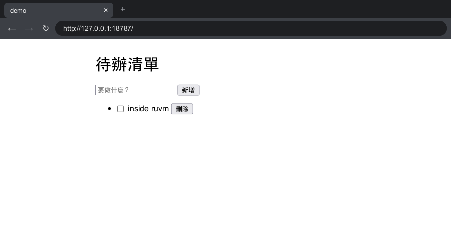

# 以瀏覽器為介面的手機＋桌機系統

這份規劃已經搬到整合專案 [ruwebos](https://github.com/ccc-claude-opus/ruwebos)：

* [ruwebos doc/plan.md](https://github.com/ccc-claude-opus/ruwebos/blob/main/doc/plan.md)：整體目標、已決定的事、五個階段
* [ruwebos doc/stage1.md](https://github.com/ccc-claude-opus/ruwebos/blob/main/doc/stage1.md)：階段 1，一個指令 `./ruwebos` 從關機到 rubrowser 顯示主畫面約 5 秒

rubrowser 在系統裡是唯一的使用者介面；`scripts/linux/rucloud-ruvm.sh` 是開 ruwebos 之前手動串起來的版本，留著當單一應用的範例。

